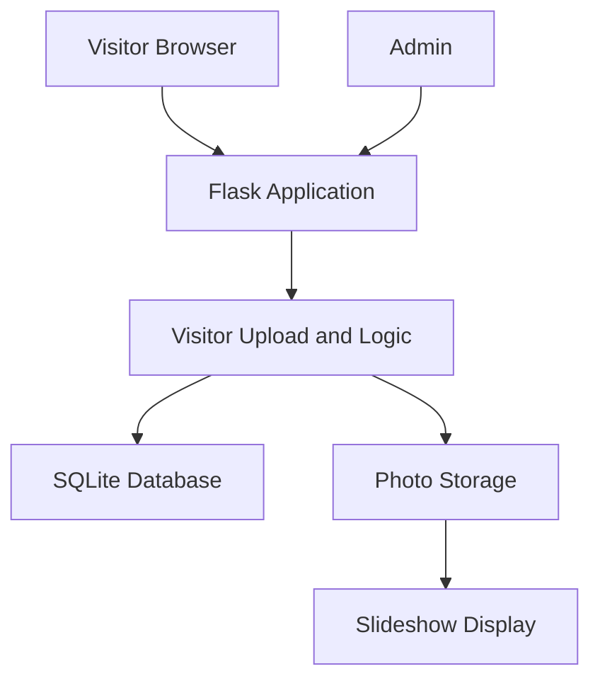

# Architecture

## Technology Stack
- Python
- Flask (web framework)
- SQLite (database)
- HTML, CSS and JavaScript (frontend)
- Flask templates for rendering web pages

## Architecture Overview

The application uses a Flask server to handle visitor requests, uploads and application logic. Uploaded photos and visitor information are managed by the application. SQLite is used for database storage.

## Architecture Diagram

## Main Components

| Component | Responsibility |
|---|---|
| Flask application | Handles application routes and requests |
| Database | Stores visitor-related records |
| Photo storage | Stores uploaded images |
| Visitor interface | Allows visitors to submit their information and photos |
| Slideshow | Displays uploaded photos |
| Admin functionality | Provides administrative operations |

## Data Model

- Visitor: Stores visitor-related information.
- Photo: Stores information about uploaded photographs and their associated visitors.

## Data Flow

1. Visitor opens the application.
2. Visitor submits their name and photographs.
3. The application processes the upload.
4. Visitor and photo information is stored.
5. Photos are made available for slideshow display.
6. Returning visitor information can be retrieved to include previously uploaded photos.

## Security Considerations

- Validate uploaded files.
- Restrict file sizes.
- Protect administrative functionality.
- Avoid committing secrets or credentials to GitHub.
